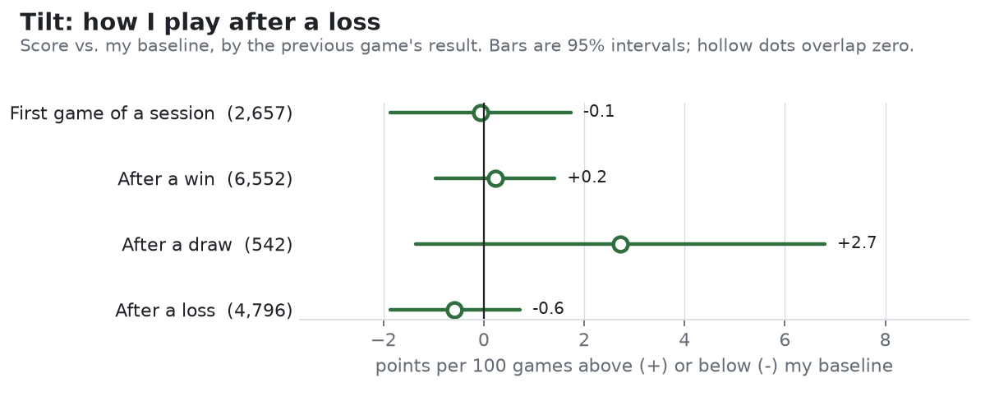
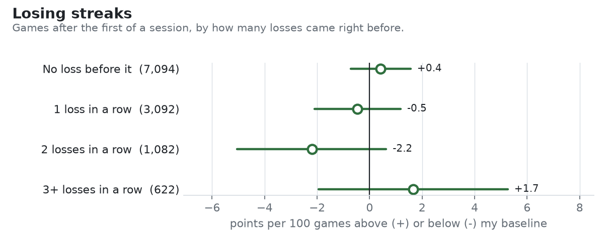
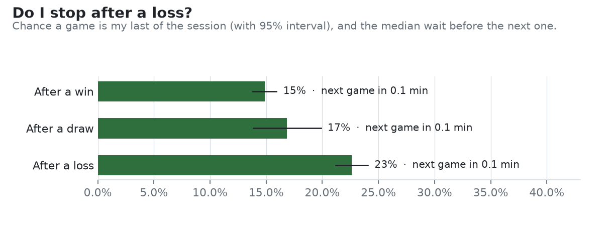
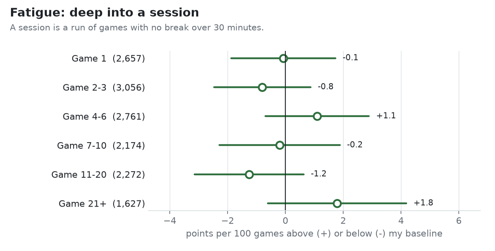
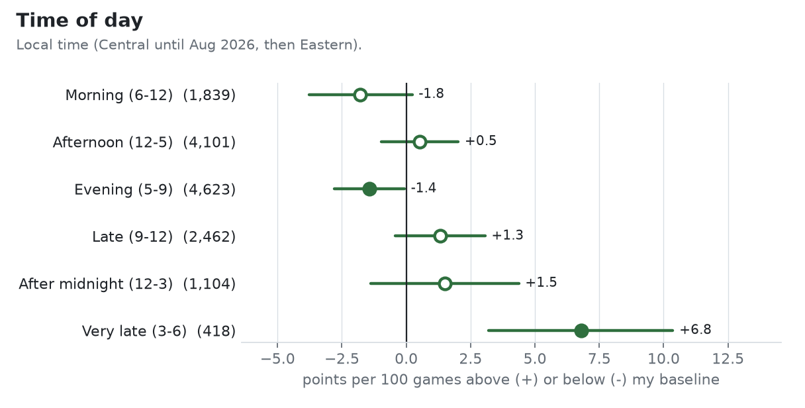
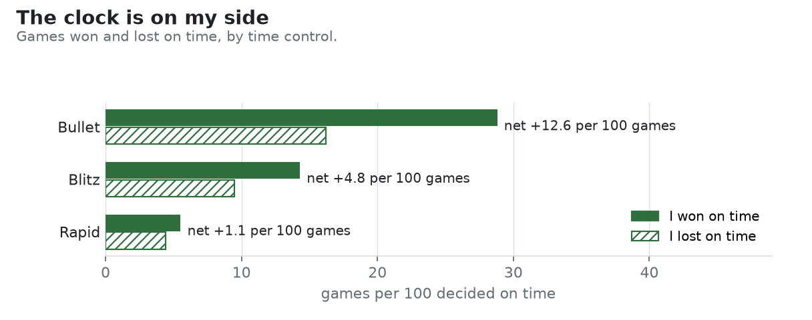
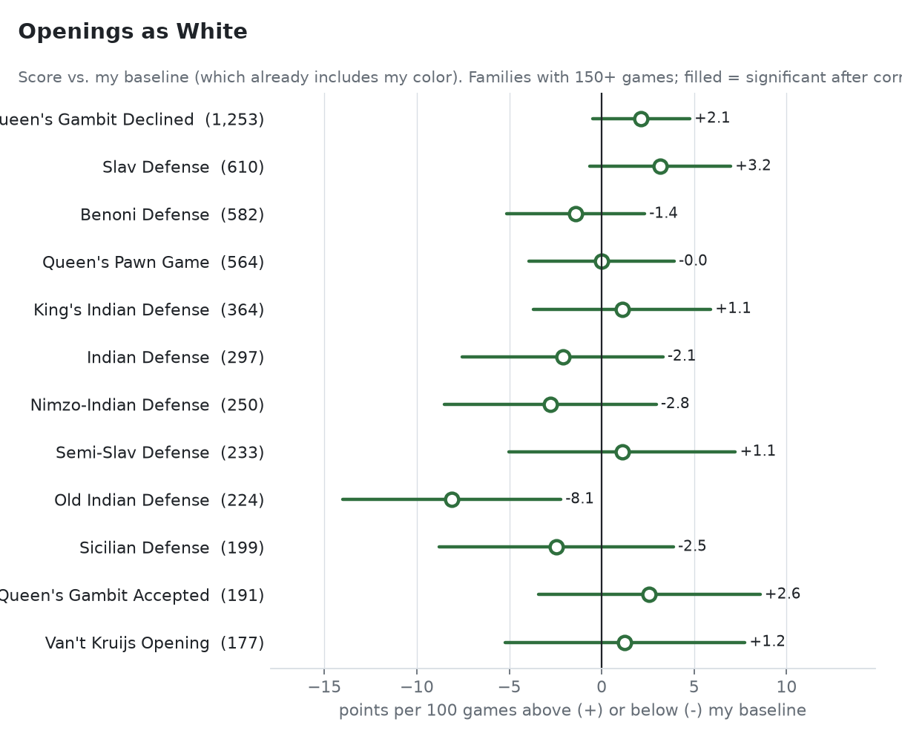
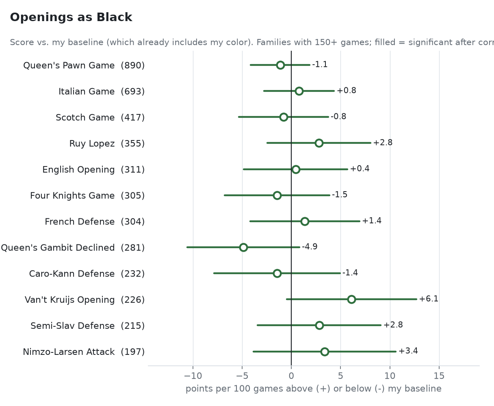
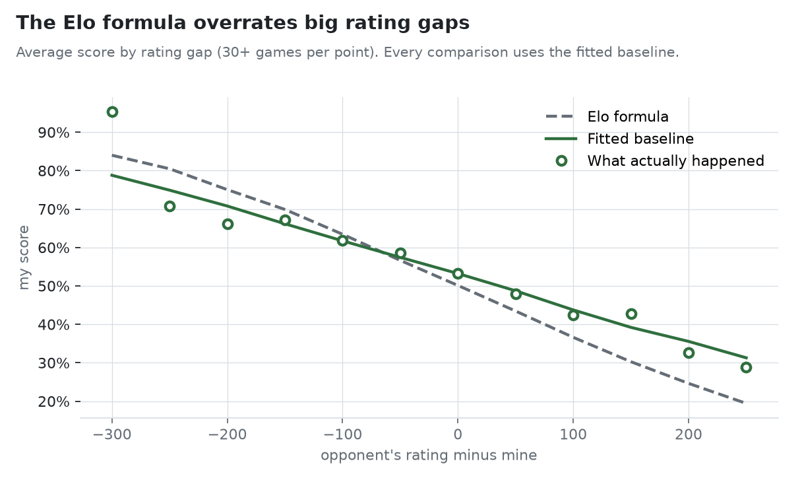

# Do I tilt? What 14,547 of my chess games say

I've played **14,547 rated games** online since 2017: 9,272 on Lichess and 5,275 on Chess.com, mostly bullet. Chess players tell themselves a lot of stories about how they play: *I tilt after a loss. I should stop after a few games. I play worse late at night. My opening is the problem.* This project pulls every one of my games from both sites and tests those stories against what actually happened.

It's live and explorable on my site: **[aayush-thakkar.vercel.app/projects/chess-analytics](https://aayush-thakkar.vercel.app/projects/chess-analytics/)**.

| Question | Answer |
|---|---|
| Do I play worse after a loss? | **No.** After a loss I score within noise of after a win. |
| So what does a loss change? | **Whether I keep playing.** I end the session 23% of the time after a loss, 15% after a win. That's on purpose. |
| Do I fade deep into a session? | **No pattern**, from game 1 to game 21+. |
| When do I play best? | **Late at night.** 5–9 PM is my weakest window; 3–6 AM my strongest. |
| Who wins the time scramble? | **Me.** In bullet I win 12.6 more games per 100 on time than I lose. |
| Which openings work for me? | **None stands out** once the numbers are corrected. The ones that looked best were just White's first-move advantage. |

## The findings

Every comparison asks the same thing: **did I score more or less than I usually do in that situation?** The baseline accounts for the rating gap, my color, the site and time control, and the year (see [the baseline](#the-baseline-what-i-usually-score)). Results are in **points per 100 games**; near an even matchup, 1 point per 100 games is worth about 7 rating points. Bars are 95% intervals; a hollow dot means the interval includes zero.

### 1. Tilt: I don't play worse after a loss



After a loss I score −0.6 points per 100 games against my baseline; after a win, +0.2. In the full model with everything else held equal, the difference is −0.6 (95% interval −2.4 to +1.2). That's a precise zero: the interval rules out a loss costing me more than about 17 rating points of strength in the next game.

Streaks don't change it either. Two losses in a row is the closest thing to tilt in the data (−2.2, interval −5.0 to +0.6), but three or more in a row comes out positive (+1.7). There's no consistent slide.



### 2. What a loss does change: whether I keep playing



I end the session after **22.6%** of losses (95% interval 21.2–24.1%) but only **14.9%** of wins (13.8–15.9%). When I do keep going, the next game starts 5 to 6 seconds later either way.

That's deliberate: stopping after a loss that gets to me is how I avoid tilt. Finding 1 says the habit works. The games I would have tilted in mostly never get played.

### 3. Fatigue: no fade, even 20 games in



A session is a run of games with no break longer than 30 minutes. Half my sessions are two games or fewer; the longest was 92. Games 11–20 are the low point (−1.3), and games 21 and later are the high point (+1.8). Every interval includes zero, and the model agrees: nothing here.

### 4. Time of day: worst in the evening, best when I should be asleep



My weakest window is 5–9 PM (−1.4, interval −2.8 to −0.1). Compared with that, I score 3.4 points per 100 games better from 9 PM to midnight and **7.6 better from 3 to 6 AM** (interval 3.8 to 11.4, 418 games). That's worth about 50 rating points.

That's about who I play more than how I play. The players online at that hour are a different pool: night owls, and people starting their morning in Europe or Asia, whom I tend to do well against. This shows *when* I score best, not that I play better tired.

### 5. The clock is on my side



| | Won on time | Lost on time | Net per 100 games |
|---|---:|---:|---:|
| Bullet (10,084 games) | 28.8 per 100 | 16.2 per 100 | **+12.6** |
| Blitz (3,034) | 14.3 | 9.5 | +4.8 |
| Rapid (1,376) | 5.5 | 4.4 | +1.1 |

In bullet, more than half my wins (56%) come on time. Speed is a real part of how I win, and it matters less the more time each side has.

### 6. Openings: what looked like a finding wasn't



I play 1.d4 in 81% of my White games. On the first pass, the Queen's Gambit Declined (+7.0) and the Slav (+8.6) looked like my best openings, both clearly above zero. They were just the first-move advantage: every White opening looks good if you compare it to a baseline that ignores color. Measured against my usual White results, they shrink to +2.1 and +3.2, inside the noise.

Testing 30 openings also means some will look significant by luck, so results are corrected for multiple comparisons. After that correction no opening, as White or Black, stands out. The biggest candidate is the Old Indian Defense as White (−8.1, 224 games, corrected q = 0.09). It's a lead worth studying, not a proven weakness.



## The baseline: what I usually score

The obvious baseline is the Elo formula: from the rating gap, predict a score (50% against an equal opponent, 76% against someone 200 points lower). It doesn't fit my games:



The formula overrates big gaps. Against players 150 points above me it predicts 30%; I score 43%. Against players 200 points below it predicts 75%; I score 66%. That matters here: after a win, my next opponent averages 39 points below me, and after a loss only 15. With the Elo formula as the baseline, that difference alone would make games after a loss look better than they were.

So the baseline is fitted instead: a logistic curve of my score on the rating gap, my color, the site and time control, and the year, across all 14,547 games. Each comparison above asks how far a group lands from it. (Against the plain Elo formula I score 2.3 points per 100 games above prediction overall, mostly because ratings lag behind a player who's improving.)

## How it works

```
Chess.com API ──┐                                   ┌─ sql/*.sql in DuckDB ──┐
                ├─ fetch.py ─ build.py ─ games.parquet ├─ baseline + regression ├─ results/
Lichess API ────┘                                   └─ (statsmodels)  ───────┘
```

1. **Fetch** (`scripts/fetch.py`). Every rated game from both public APIs. Chess.com serves one file per month; Lichess streams games oldest first, and when the stream drops, the script resumes from the newest saved game. Raw files stay local because they include opponents' usernames.
2. **Clean** (`scripts/build.py`, `src/chess_analytics/`). One row per game from my side of the board: time control, color, both ratings before the game, result, how it ended, clocks at the end, opening, and the first two moves. Both sites' endings map to one vocabulary (checkmate, resign, time, draw, abandon). Chess.com games get Lichess's opening names through their shared ECO codes.
3. **Sessions.** A run of games, on either site, with no break over 30 minutes. Each game knows its number in the session, the previous result, the losing streak before it, and whether it ended the night. Local time switches from Central to Eastern when I moved from Illinois to Ohio in August 2026.
4. **Analyze** (`scripts/analyze.py`, `sql/`). The group comparisons, stop rates, clock results, and calibration are SQL queries run in DuckDB. The baseline and the regression run in statsmodels; charts are matplotlib. `results/summary.json` holds every number in this README.

### Honest error bars

- **Clustered by session.** Games on the same night aren't independent: one bad night drags down several games at once. Treating them as independent would make every interval too narrow, so deviations are summed within each session before computing the standard error (`sql/group_effect.sql`).
- **One model for everything.** Late-night games are also games deep into long sessions, so one effect can pass for another. A regression puts previous result, session depth, and time of day in one model, plus the rating gap again in case its effect isn't a straight line (`results/regression.txt`).
- **Many openings, many chances to fool myself.** Opening results are corrected with the Benjamini-Hochberg procedure, and only openings with at least 150 games are shown.
- **Small groups are dropped.** Any group under 40 games is left out, because its interval would be too wide to mean anything.

### Checks

`pytest` runs 17 tests. They cover both sites' formats, every way a game can end, session splitting, local time across the move, and the statistics: the SQL interval is checked against a hand-written numpy version, clustering is checked to widen intervals when games share a bad night, and the false-discovery correction is checked against a worked example.

One data check mattered more than any test. Chess.com's archive stores each player's rating **after** the game, not before. The sign of the rating change matches that game's result in 91–93% of games (the rest are draws), so `build.py` rebuilds each pre-game rating from the previous game.

### Limits

- Results, not quality. Without running an engine over 14,547 games, the analysis sees who won, not how well either side played.
- The opponent pool changes by hour and by year, and the data can't fully separate my form from theirs.
- Online only. My over-the-board US Chess games aren't in these APIs.

## Run it

```bash
python -m venv .venv
.venv/Scripts/activate            # macOS/Linux: source .venv/bin/activate
pip install -e ".[dev]"
python scripts/fetch.py           # about an hour the first time; Lichess streams slowly
python scripts/build.py
python scripts/analyze.py
pytest
```

`data/games.parquet` is committed, so `analyze.py` runs without fetching anything. Change `accounts.json` to analyze someone else's games.

## Reflection

**Why I did it.** I wanted an analytics project with real data and real questions, not a cleaned-up practice dataset. My own games were the obvious choice: 14,000+ rows I understand better than anyone, and questions I actually wanted answered. I had believed for years that I tilt after losses.

**What it showed me about analysis.** The first answers were wrong twice. The Elo formula looked like a fine baseline until the calibration chart showed it overrates big gaps, and the gap shifts after wins and losses, which would have skewed the tilt result. Then my best openings turned out to be the first-move advantage in disguise. Both times, the mistake was hiding in the baseline, not in the effect I was looking at. Checking what you compare against is most of the work.

**What it showed me about me.** I don't tilt, because I stop after losses that get to me, and now there are numbers that say the habit works. My best hours are late at night, thanks to who's online then. And in bullet the clock is a weapon for me: I win 12.6 more games per 100 on time than I lose.

**What I'd do next.** Run an engine over a sample of games to measure move quality, not just results, which would separate my form from my opponents' at 4 AM.

## Skills

SQL (DuckDB) · Python (pandas, statsmodels, matplotlib) · Statistics: logistic baselines, clustered standard errors, regression with controls, false discovery rate · Data cleaning across two APIs · Data visualization · Testing (pytest)

## License

MIT
